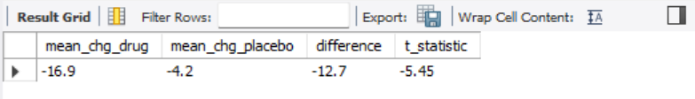

# Clinical Trial Data Analysis in MySQL

A Phase II trial of **Drug A vs Placebo** for blood pressure, analysed end-to-end in MySQL using **synthetic data** (60 patients, 30 per arm).

## What this project covers
- Relational database design (3 tables, primary and foreign keys)
- Data quality checks (orphan records, missing visits, implausible values)
- Analysis dataset with change-from-baseline derivation (SQL view)
- Efficacy analysis: mean change by visit and a Welch t-statistic computed in SQL
- Safety summary: adverse events by arm
- Reusable stored procedure for the efficacy test at any visit

## Tables
| Table | Contents |
|---|---|
| `dm` | Demographics: age, sex, arm, site |
| `vs` | Vital signs: SBP and DBP at Baseline, Week 4, Week 8 |
| `ae` | Adverse events: term, severity, relation to drug |

## Results (from one run of the script)

**Efficacy: systolic BP by visit (mmHg)**

| Arm | Baseline | Week 4 | Week 8 | Change at Week 8 |
|---|---|---|---|---|
| Drug A | 151.5 | 142.9 | 134.5 | -16.9 |
| Placebo | 150.6 | 148.2 | 146.4 | -4.2 |

At Week 8, Drug A lowered SBP by 12.7 mmHg more than Placebo (t = -5.45, p < 0.001).

**Safety**

| Arm | Patients | With at least one AE | % |
|---|---|---|---|
| Drug A | 30 | 17 | 56.7 |
| Placebo | 30 | 10 | 33.3 |

AEs were more frequent on Drug A (23.4 percentage points higher). With 30 patients per arm this difference is not statistically conclusive (Fisher's exact p of about 0.12).

**Conclusion:** Drug A produced a large, statistically significant extra reduction in systolic BP versus Placebo at Week 8, alongside a numerically higher rate of adverse events. A larger trial would be needed to confirm the safety signal.

## Files
- `clinical_trial_project.sql`: the full script (build, checks, analysis, tables, stored procedure)
- `table2_sbp_by_visit.csv`, `table3_efficacy.csv`, `table4_safety.csv`: exported results
- `results_screenshot.png`: Table 3 output in MySQL Workbench

## How to run
1. Install MySQL 8.0+ and MySQL Workbench.
2. Open `clinical_trial_project.sql` in Workbench, select all (Ctrl+A) and run it.
3. Results appear as tabs under the editor.

## Notes
- Data is randomly generated, so exact numbers differ on every run. The Drug A effect is built into the simulation.
- The t-statistic is computed manually (Welch's formula). A p-value needs a t-distribution table or a stats package.

## Skills demonstrated
SQL joins, CTEs, views, aggregation, stored procedures, data validation, CDISC-style table naming, efficacy and safety reporting.
